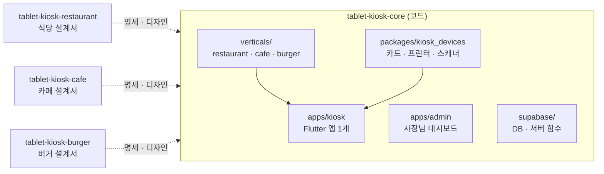
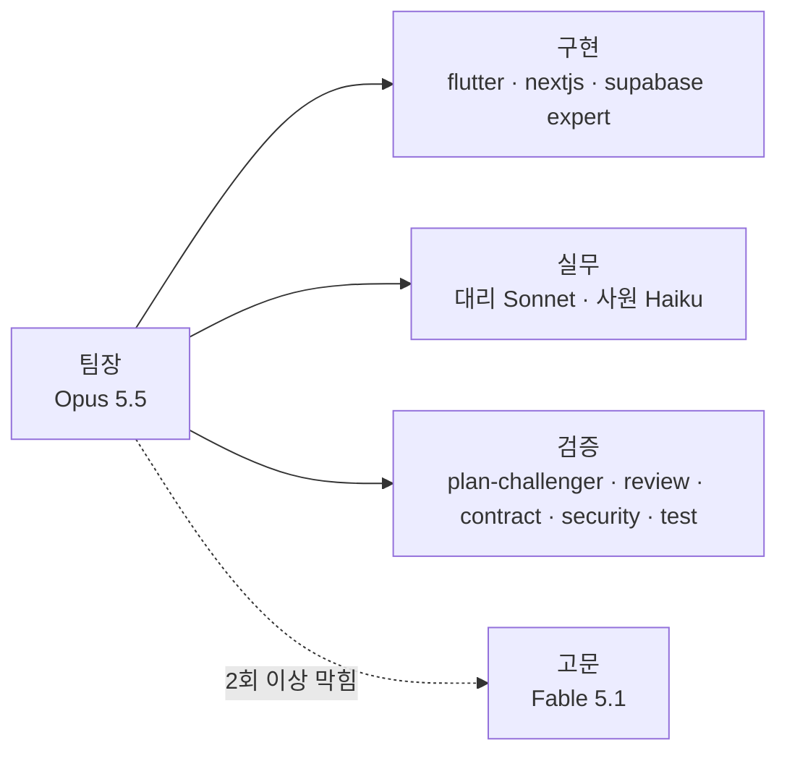

# tablet-kiosk-core

식당 · 카페 · 버거 매장용 **태블릿 키오스크 공통 코어** 저장소입니다.
앱은 하나로 만들고, 사장님이 세팅 2단계에서 고른 업종에 따라 식당 · 카페 · 버거 기능이 붙습니다.

> **현재 상태: 개발 구조 · 개발 지침 · 멀티에이전트 팀만 있음 (코드 없음).**
> 실제 개발은 Claude Code CLI로 `tasks/`의 순서대로 진행합니다.

## 저장소 구성

| 저장소 | 역할 |
|---|---|
| **tablet-kiosk-core** (여기) | 실제 코드 — 키오스크 앱(Flutter), 사장님 대시보드(Next.js), 서버(Supabase), 기기 연동 |
| [tablet-kiosk-restaurant](https://github.com/DevOps0906/tablet-kiosk-restaurant) | 식당 설계서 — 기획 · 디자인 · 화면 명세 |
| [tablet-kiosk-cafe](https://github.com/DevOps0906/tablet-kiosk-cafe) | 카페 설계서 (MVP 첫 업종) |
| [tablet-kiosk-burger](https://github.com/DevOps0906/tablet-kiosk-burger) | 버거 설계서 |



## 폴더 구조

```
tablet-kiosk-core/
├── CLAUDE.md              Claude Code 작업 규칙 (먼저 읽기)
├── PRD.md                 무엇을 만드나
├── DESIGN.md              공통 디자인 시스템 · 업종 테마
├── docs/                  개발 지침 00–11
├── NOTICE                 출처 · 라이선스
├── tasks/                 작업 목록 task-000 ~ 027
├── .claude/
│   ├── settings.json      팀장 모델 (Opus 5.5)
│   ├── agents/            멀티에이전트 팀 (고문 · 대리 · 사원 · 분야 3 · 검증 5)
│   ├── skills/            분야별 규약 · 함정 (flutter · nextjs · supabase)
│   └── commands/          /next-task · /check · /sync-design · /agent-check
├── apps/
│   ├── kiosk/             Flutter 키오스크 앱 (task-001에서 생성)
│   └── admin/             Next.js 사장님 대시보드 (task-022에서 생성)
├── packages/
│   └── kiosk_devices/     기기 연동 패키지 (task-004에서 생성)
└── supabase/              DB 마이그레이션 · Edge Functions (task-005에서 생성)
```

## 기술 스택

| 영역 | 선택 |
|---|---|
| 키오스크 앱 | Flutter (Android 실제 매장 · Windows 개발 확인), Riverpod, go_router, drift |
| 서버 | Supabase — Postgres(스키마 `kiosk`) · Auth · Realtime · Edge Functions |
| 사장님 대시보드 | Next.js 16.4 · React 19 · TypeScript · Tailwind v4 · shadcn/ui (반응형 3구간) |
| 카드 결제 | VAN사 SDK 또는 앱투앱 (Kotlin 플랫폼 채널) — VAN사 결정 대기 |
| 프린터 | ESC/POS + TCP 9100 (LAN) |
| 바코드 | USB · 블루투스 스캐너 + 카메라 |

## 개발 지침

| 문서 | 내용 |
|---|---|
| [docs/00-overview.md](docs/00-overview.md) | 린 검증 게이트 · 용어집 · 결정 대기 목록 · 개발 단계 |
| [docs/01-architecture.md](docs/01-architecture.md) | 전체 구조 · 계층 규칙 · 주문 데이터 흐름 · 인터넷 끊김 정책 |
| [docs/02-dev-environment.md](docs/02-dev-environment.md) | **윈도우 PC에서 개발 · 확인하는 방법**, 가짜 기기 모드 |
| [docs/03-device-integration.md](docs/03-device-integration.md) | 카드 단말 · 프린터 · 바코드 · 키오스크 잠금 |
| [docs/04-payment.md](docs/04-payment.md) | 전체결제 · 더치페이 상태 흐름, 실패 · 취소 · 환불 |
| [docs/05-printing.md](docs/05-printing.md) | 주문서 · 영수증 양식, 출력 대기열 |
| [docs/06-coupon.md](docs/06-coupon.md) | 쿠폰 발행 · 검증 · 사용 |
| [docs/07-data-model.md](docs/07-data-model.md) | 테이블 · 관계도 · RLS |
| [docs/08-vertical-module.md](docs/08-vertical-module.md) | 업종 모듈 구조 (확장 지점) |
| [docs/09-accessibility.md](docs/09-accessibility.md) | 배리어프리 키오스크 대응 |
| [docs/10-qa-release.md](docs/10-qa-release.md) | 테스트 · 출시 체크리스트 |
| [docs/11-multi-agent.md](docs/11-multi-agent.md) | **멀티에이전트 팀** 구성 · 위임 · 검증 규칙 |

## 개발 시작하기 (PC 준비)

### 1. 폴더 구조 — core 옆에 업종 저장소를 둡니다

```
kiosk/                          ← 빈 작업 폴더 하나
├── tablet-kiosk-core/          ← ① 실제 코드 (여기서 Claude Code 실행)
└── tablet-kiosk-restaurant/    ← ② 작업할 업종 설계서 (core 와 나란히)
```

- 업종 저장소는 core **안이 아니라 옆에** 클론합니다. core 안에 넣으면 저장소 안에 저장소가 생겨 git 이 꼬입니다.
- 다른 업종을 작업할 때는 `tablet-kiosk-cafe`, `tablet-kiosk-burger`를 같은 `kiosk/` 폴더에 추가로 클론합니다.

### 2. 클론

```bash
mkdir kiosk && cd kiosk
git clone https://github.com/DevOps0906/tablet-kiosk-core
git clone https://github.com/DevOps0906/tablet-kiosk-restaurant   # 식당
git clone https://github.com/DevOps0906/tablet-kiosk-cafe         # 카페 (MVP 첫 업종)
git clone https://github.com/DevOps0906/tablet-kiosk-burger       # 버거
```

### 3. 편집기

| 도구 | 용도 |
|---|---|
| **VS Code** (권장) | 메인 작업 도구. `kiosk/` 폴더를 통째로 열면 core 와 업종 설계서가 함께 보이고, Flutter · Next.js 를 모두 다룹니다 |
| Android Studio | 설치만 합니다. Android SDK · 에뮬레이터용이며 코드 편집에는 거의 쓰지 않습니다 |

설치 목록 · 실행 방법은 [docs/02-dev-environment.md](docs/02-dev-environment.md).

### 4. Claude Code 실행 — core 에서, 업종 설계서를 함께 열기

VS Code 터미널에서:

```bash
cd tablet-kiosk-core
claude --add-dir ../tablet-kiosk-cafe          # 카페 작업 (task-001~022, MVP)
claude --add-dir ../tablet-kiosk-restaurant    # 식당 작업 (task-023)
claude --add-dir ../tablet-kiosk-burger        # 버거 작업 (task-024)
```

Claude Code 안에서:

```
/agent-check     ← 처음 한 번: 팀 에이전트가 제대로 잡혔는지 확인
/next-task       ← 다음 작업을 골라 계획 → 승인 → 팀으로 진행
```

> 식당 모듈은 task-023(Phase 6)입니다. 공통 기반(001–006)과 결제 · 출력 · 쿠폰이 먼저 끝나야 합니다.

## 멀티에이전트 팀

Claude Code 세션이 **팀장**이 되어 작업을 나눠 맡기고 검토합니다. 팀은 core 에 한 번만 들어 있고, 어느 업종 설계서를 옆에 열든 같은 팀이 일합니다.



| 분류 | 에이전트 | 모델 | 하는 일 |
|---|---|---|---|
| 고문 | advisor | Fable 5.1 | 팀장이 2회 이상 막힌 문제만 진단 · 권고 (읽기 전용) |
| 팀장 | 주 세션 | Opus 5.5 | task 분해 · 위임 · 검토 · 커밋 |
| 대리 / 사원 | sub-agent-1 / sub-agent-2 | Sonnet 5.5 / Haiku 5.5 | 판단 필요 실무 / 단순 반복 (탐색 · 값 추출 · 시드 정리) |
| 구현 | flutter-expert · nextjs-expert · supabase-expert | Sonnet 5.5 | 키오스크 앱 · 기기 / 대시보드 / DB · RLS · Edge Function |
| 검증 | plan-challenger | Opus 5.5 | 결제 · 쿠폰 · 기기 · DB task 착수 전 계획 공격 |
| 검증 | review-expert · contract-reviewer · security-auditor · test-writer | Sonnet 5.5 | 변경 후 리뷰 · 경계 계약 대조 · 보안 감사 · 테스트 |

상세(누구에게 맡기나, task 별 배치, 프레임워크에서 옮긴 것과 뺀 것): [docs/11-multi-agent.md](docs/11-multi-agent.md)
구성은 [MultiAgent-Service-Fullstack-Tree-Framwork](https://github.com/DevOps0906/MultiAgent-Service-Fullstack-Tree-Framwork)에서 필요한 것만 옮겼습니다 ([NOTICE](NOTICE)).

## 개발 단계

| Phase | 내용 | 작업 |
|---|---|---|
| 0 | 멀티에이전트 팀 이식 (완료) | 000 |
| 1 | 기반: 앱 생성, 테마, 업종 모듈 구조, 가짜 기기, DB | 001–006 |
| 2 | 손님 주문 MVP (카페 · 갤럭시탭형) | 007–013 |
| 3 | 사장님 세팅 · 키오스크 잠금 | 014–015 |
| 4 | 실제 기기 (LAN 프린터 · VAN 카드 단말) | 016–017 |
| 5 | 더치페이 · 스탬프 · 쿠폰 · 대시보드 | 018–022 |
| 6 | 식당 · 버거 모듈, 스탠드형, 접근성 | 023–026 |
| 7 | QA · 시범 매장 · 출시 | 027 |

---
© 디지털노마드연구소
