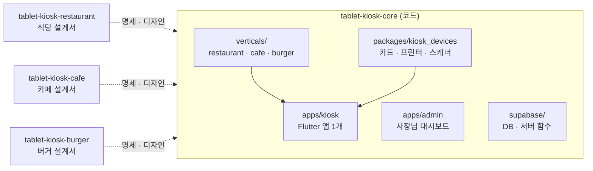

# tablet-kiosk-core

식당 · 카페 · 버거 매장용 **태블릿 키오스크 공통 코어** 저장소입니다.
앱은 하나로 만들고, 사장님이 세팅 2단계에서 고른 업종에 따라 식당 · 카페 · 버거 기능이 붙습니다.

> **현재 상태: 개발 구조 · 개발 지침만 있음 (코드 없음).**
> 실제 개발은 Claude Code CLI로 `tasks/`의 순서대로 진행합니다.

## 저장소 구성

| 저장소 | 역할 |
|---|---|
| **tablet-kiosk-core** (여기) | 실제 코드 — 키오스크 앱(Flutter), 사장님 대시보드(Next.js), 서버(Supabase), 기기 연동 |
| [tablet-kiosk-restaurant](https://github.com/DevOps0906/tablet-kiosk-restaurant) | 식당 설계서 — 기획 · 디자인 · 화면 명세 |
| [tablet-kiosk-cafe](https://github.com/DevOps0906/tablet-kiosk-cafe) | 카페 설계서 (MVP 첫 업종) |
| [tablet-kiosk-burger](https://github.com/DevOps0906/tablet-kiosk-burger) | 버거 설계서 |



## 폴더 구조

```
tablet-kiosk-core/
├── CLAUDE.md              Claude Code 작업 규칙 (먼저 읽기)
├── PRD.md                 무엇을 만드나
├── DESIGN.md              공통 디자인 시스템 · 업종 테마
├── docs/                  개발 지침 00–10
├── tasks/                 작업 목록 task-001 ~ 027
├── .claude/commands/      /next-task · /check · /sync-design
├── apps/
│   ├── kiosk/             Flutter 키오스크 앱 (task-001에서 생성)
│   └── admin/             Next.js 사장님 대시보드 (task-022에서 생성)
├── packages/
│   └── kiosk_devices/     기기 연동 패키지 (task-004에서 생성)
└── supabase/              DB 마이그레이션 · Edge Functions (task-005에서 생성)
```

## 기술 스택

| 영역 | 선택 |
|---|---|
| 키오스크 앱 | Flutter (Android 실제 매장 · Windows 개발 확인), Riverpod, go_router, drift |
| 서버 | Supabase — Postgres(스키마 `kiosk`) · Auth · Realtime · Edge Functions |
| 사장님 대시보드 | Next.js 16.4 · React 19 · TypeScript · Tailwind v4 · shadcn/ui (반응형 3구간) |
| 카드 결제 | VAN사 SDK 또는 앱투앱 (Kotlin 플랫폼 채널) — VAN사 결정 대기 |
| 프린터 | ESC/POS + TCP 9100 (LAN) |
| 바코드 | USB · 블루투스 스캐너 + 카메라 |

## 개발 지침

| 문서 | 내용 |
|---|---|
| [docs/00-overview.md](docs/00-overview.md) | 린 검증 게이트 · 용어집 · 결정 대기 목록 · 개발 단계 |
| [docs/01-architecture.md](docs/01-architecture.md) | 전체 구조 · 계층 규칙 · 주문 데이터 흐름 · 인터넷 끊김 정책 |
| [docs/02-dev-environment.md](docs/02-dev-environment.md) | **윈도우 PC에서 개발 · 확인하는 방법**, 가짜 기기 모드 |
| [docs/03-device-integration.md](docs/03-device-integration.md) | 카드 단말 · 프린터 · 바코드 · 키오스크 잠금 |
| [docs/04-payment.md](docs/04-payment.md) | 전체결제 · 더치페이 상태 흐름, 실패 · 취소 · 환불 |
| [docs/05-printing.md](docs/05-printing.md) | 주문서 · 영수증 양식, 출력 대기열 |
| [docs/06-coupon.md](docs/06-coupon.md) | 쿠폰 발행 · 검증 · 사용 |
| [docs/07-data-model.md](docs/07-data-model.md) | 테이블 · 관계도 · RLS |
| [docs/08-vertical-module.md](docs/08-vertical-module.md) | 업종 모듈 구조 (확장 지점) |
| [docs/09-accessibility.md](docs/09-accessibility.md) | 배리어프리 키오스크 대응 |
| [docs/10-qa-release.md](docs/10-qa-release.md) | 테스트 · 출시 체크리스트 |

## Claude Code CLI로 시작하기

```bash
# 1. 네 저장소를 같은 폴더에 클론
mkdir kiosk && cd kiosk
git clone https://github.com/DevOps0906/tablet-kiosk-core
git clone https://github.com/DevOps0906/tablet-kiosk-restaurant
git clone https://github.com/DevOps0906/tablet-kiosk-cafe
git clone https://github.com/DevOps0906/tablet-kiosk-burger

# 2. 코어에서 Claude Code 실행 (MVP는 카페 설계서를 함께 염)
cd tablet-kiosk-core
claude --add-dir ../tablet-kiosk-cafe

# 3. Claude Code 안에서
/next-task
```

`/next-task`는 `tasks/README.md`에서 다음 작업을 골라 계획을 보여 주고, 승인하면 진행합니다.

## 개발 단계

| Phase | 내용 | 작업 |
|---|---|---|
| 1 | 기반: 앱 생성, 테마, 업종 모듈 구조, 가짜 기기, DB | 001–006 |
| 2 | 손님 주문 MVP (카페 · 갤럭시탭형) | 007–013 |
| 3 | 사장님 세팅 · 키오스크 잠금 | 014–015 |
| 4 | 실제 기기 (LAN 프린터 · VAN 카드 단말) | 016–017 |
| 5 | 더치페이 · 스탬프 · 쿠폰 · 대시보드 | 018–022 |
| 6 | 식당 · 버거 모듈, 스탠드형, 접근성 | 023–026 |
| 7 | QA · 시범 매장 · 출시 | 027 |

---
© 디지털노마드연구소
