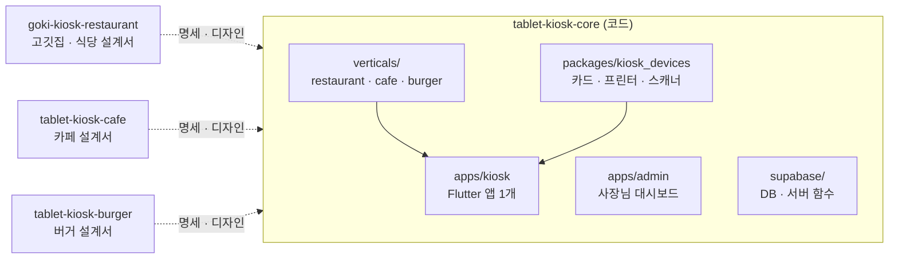

# tablet-kiosk-core

식당 · 카페 · 버거 매장용 **태블릿 키오스크 공통 코어** 저장소입니다.
앱은 하나로 만들고, 사장님이 세팅 2단계에서 고른 업종에 따라 식당 · 카페 · 버거 기능이 붙습니다.

> **현재 상태: 개발 구조 · 개발 지침 · 멀티에이전트 팀만 있음 (코드 없음).**
> 실제 개발은 Claude Code CLI로 `tasks/`의 순서대로 진행합니다.

## 저장소 구성

| 저장소 | 역할 |
|---|---|
| **tablet-kiosk-core** (여기) | 실제 코드 — 키오스크 앱(Flutter), 사장님 대시보드(Next.js), 서버(Supabase), 기기 연동 |
| [goki-kiosk-restaurant](https://github.com/DevOps0906/goki-kiosk-restaurant) | 고깃집 · 식당 설계서 — 카운터 키오스크 + **테이블오더(후불 · 선불)** · 카운터 정산 |
| [tablet-kiosk-cafe](https://github.com/DevOps0906/tablet-kiosk-cafe) | 카페 설계서 (MVP 첫 업종) |
| [tablet-kiosk-burger](https://github.com/DevOps0906/tablet-kiosk-burger) | 버거 설계서 |



## 폴더 구조

> 지금은 문서 · 규칙 · 팀 설정만 있고 코드는 없습니다. `(예정 · task-XXX)`는 그 작업에서 생기는 폴더입니다.

```
tablet-kiosk-core/
│
├── CLAUDE.md                    # Claude Code 가 가장 먼저 읽는 규칙
│                                #   반드시 지킬 규칙: 기기 직접 호출 금지 · 업종 분기 금지 ·
│                                #   금액은 정수(원) · 카드 정보 저장 금지 · 멱등 키
│                                #   커밋 형식 · 멀티에이전트 운영 · 운영 원칙 4가지
├── README.md                    # 이 문서
├── PRD.md                       # 무엇을 만드나: 대상 고객 · 기능 범위 · MVP · 성공 지표
├── DESIGN.md                    # 어떻게 보이나: 공통 디자인 토큰 · 업종 테마 색 · 화면 규격
├── NOTICE                       # 출처 · 라이선스 (운영 원칙, 멀티에이전트 프레임워크)
├── .env.example                 # 환경 변수 이름만 (값은 넣지 않음)
├── .gitignore
│
├── docs/                        # 개발 지침 00–11
│   ├── 00-overview.md           #   린 검증 조건 · 용어집 · 결정 대기 목록(D1 VAN사 등 8개)
│   ├── 01-architecture.md       #   전체 구조 · 앱 폴더 구조 · 인터넷 끊김 정책
│   ├── 02-dev-environment.md    #   윈도우 개발 · VS Code · 가짜 기기 모드 · 실기 연결
│   ├── 03-device-integration.md #   카드 단말(VAN) · 프린터 · 바코드 스캐너 · 키오스크 잠금
│   ├── 04-payment.md            #   전체결제 · 더치페이 상태 흐름 · 거절 · 취소 · 환불 · 멱등 키
│   ├── 05-printing.md           #   주문서 · 영수증 양식 · ESC/POS · 출력 대기열
│   ├── 06-coupon.md             #   쿠폰 발행 · 확인 · 예약 · 사용 확정 · 오류 문구
│   ├── 07-data-model.md         #   테이블 설계 · 매장별 접근 권한(RLS)
│   ├── 08-vertical-module.md    #   업종 모듈 구조 (식당 · 카페 · 버거를 끼우는 확장 지점)
│   ├── 09-accessibility.md      #   배리어프리 키오스크 대응 (2026-01-28 시행)
│   ├── 10-qa-release.md         #   공통 테스트 시나리오 · 실기 체크리스트 · 출시
│   ├── 11-multi-agent.md        #   멀티에이전트 팀 구성 · 위임 · 검증 규칙
│   └── 12-operation-modes.md    #   운영 방식 · 테이블오더 · 열린 계산서 · 기기 역할
│
├── tasks/                       # 개발 작업 목록 (/next-task 가 여기서 다음 작업을 고름)
│   ├── README.md                #   작업 표(번호 · Phase · 선행 · 상태) · 발견한 문제
│   ├── task-000.md              #   [완료] 멀티에이전트 팀 이식
│   ├── task-001 ~ 006.md        #   Phase 1 기반: 앱 생성 · 테마 · 업종 모듈 · 가짜 기기 · DB · outbox
│   ├── task-007 ~ 013.md        #   Phase 2 손님 주문 MVP (카페 · 갤럭시탭): 시작 → 메뉴 → 결제 → 출력 → 완료
│   ├── task-014 ~ 015.md        #   Phase 3 사장님 세팅 5단계 · 키오스크 잠금
│   ├── task-016 ~ 017.md        #   Phase 4 실제 기기: LAN 프린터 · VAN 카드 단말
│   ├── task-018 ~ 022.md        #   Phase 5 더치페이 · 스탬프 · 쿠폰 서버/화면 · 사장님 대시보드
│   ├── task-023 ~ 026.md        #   Phase 6 식당 · 버거 모듈 · 스탠드형 세로 · 접근성 모드
│   ├── task-027.md              #   Phase 7 QA · 시범 매장 · 출시
│   └── task-028 ~ 034.md        #   Phase 6b 테이블오더: 계산서 스키마 · 테이블 화면 · 카운터 정산 · 호출 · 세팅 · 옵션 · 선불(PG)
│
├── apps/
│   ├── kiosk/                   # Flutter 키오스크 앱 (손님 화면 + 사장님 세팅)
│   │   ├── CLAUDE.md            #   앱 전용 규칙 (경로 이름 · 두 레이아웃 · 디자인 맞추는 법)
│   │   └── lib/                 #   (예정 · task-001)
│   │       ├── main.dart        #     시작점: 개발/운영 · 진짜/가짜 기기 선택
│   │       ├── app/             #     라우터 · 테마 주입 · 의존성 조립
│   │       ├── core/            #     공통 기능 (업종을 모름)
│   │       │   ├── ui/          #       공통 컴포넌트
│   │       │   ├── theme/       #       디자인 토큰 · 업종 테마
│   │       │   ├── money/       #       금액 계산 · 표시 (int 원)
│   │       │   ├── session/     #       주문 세션 (매장/포장 · 장바구니)
│   │       │   ├── catalog/     #       메뉴 · 분류 · 품절
│   │       │   ├── payment/     #       결제 상태 흐름 (전체 · 더치페이)
│   │       │   ├── coupon/      #       쿠폰 입력 · 서버 확인 호출
│   │       │   ├── printing/    #       주문서 → ESC/POS · 출력 대기열
│   │       │   ├── setup/       #       사장님 세팅 5단계
│   │       │   ├── kiosk_lock/  #       키오스크 잠금 · PIN 해제
│   │       │   ├── operation/   #       운영 방식 · 기기 역할(입구 · 테이블 · 카운터)
│   │       │   ├── table/       #       테이블 · 열린 계산서 · 차수 · 직원 호출
│   │       │   └── data/        #       Supabase · 로컬 DB(drift) · 동기화
│   │       ├── features/        #     손님 화면 (start · menu · cart · pay · coupon · done)
│   │       │                    #     + table_order/ (테이블 태블릿) · counter/ (카운터 정산)
│   │       └── verticals/       #     업종 모듈
│   │           ├── vertical_module.dart  # 확장 지점 인터페이스
│   │           ├── restaurant/           # 식당: 인분 · 주류 19세 · 주방 분할 출력 · 호출 항목
│   │           ├── cafe/                 # 카페: 음료 옵션 · 전화번호 스탬프
│   │           └── burger/               # 버거: 세트 · 재료 변경 · 주문번호 TV
│   │
│   └── admin/                   # Next.js 사장님 대시보드
│       └── CLAUDE.md            #   대시보드 규칙 (화면 목록 · 반응형 3구간 글자 크기)
│                                #   (예정 · task-022: 로그인 · 쿠폰 관리 · 발행)
│
├── packages/
│   └── kiosk_devices/           # 기기 연동 패키지 (화면은 이 인터페이스로만 기기 호출)
│       └── README.md            #   카드 단말 · 프린터 · 스캐너 · 잠금 × 진짜/가짜 구현
│                                #   (예정 · task-004, Kotlin 플랫폼 채널 포함)
│
├── supabase/                    # 서버
│   ├── README.md                #   스키마 kiosk · 폴더 규칙
│   ├── migrations/              #   (예정 · task-005) 번호 붙은 SQL — 기존 파일 수정 금지
│   └── functions/               #   (예정 · task-020) coupon-issue · check · reserve · redeem · release
│                                #   (예정 · task-028) table-order-submit · session-* · staff-call · device-pair
│
└── .claude/                     # Claude Code 설정 — 멀티에이전트 팀 (아래 "멀티에이전트 팀" 참고)
    ├── settings.json            #   팀장 모델 (Opus 5.5)
    ├── agents/                  #   팀원 정의 12개 + README
    ├── skills/                  #   분야별 작업 규칙 (flutter · nextjs · supabase)
    └── commands/                #   /next-task · /check · /sync-design · /agent-check
```

## 기술 스택

| 영역 | 선택 |
|---|---|
| 키오스크 앱 | Flutter (Android 실제 매장 · Windows 개발 확인), Riverpod, go_router, drift |
| 서버 | Supabase — Postgres(스키마 `kiosk`) · Auth · Realtime · Edge Functions |
| 사장님 대시보드 | Next.js 16.4 · React 19 · TypeScript · Tailwind v4 · shadcn/ui (반응형 3구간) |
| 카드 결제 | VAN사 SDK 또는 앱투앱 (Kotlin 플랫폼 채널) — VAN사 결정 대기 |
| 프린터 | ESC/POS + TCP 9100 (LAN) |
| 바코드 | USB · 블루투스 스캐너 + 카메라 |

## 개발 지침

| 문서 | 내용 |
|---|---|
| [docs/00-overview.md](docs/00-overview.md) | 린 검증 게이트 · 용어집 · 결정 대기 목록 · 개발 단계 |
| [docs/01-architecture.md](docs/01-architecture.md) | 전체 구조 · 계층 규칙 · 주문 데이터 흐름 · 인터넷 끊김 정책 |
| [docs/02-dev-environment.md](docs/02-dev-environment.md) | **윈도우 PC에서 개발 · 확인하는 방법**, 가짜 기기 모드 |
| [docs/03-device-integration.md](docs/03-device-integration.md) | 카드 단말 · 프린터 · 바코드 · 키오스크 잠금 |
| [docs/04-payment.md](docs/04-payment.md) | 전체결제 · 더치페이 상태 흐름, 실패 · 취소 · 환불 |
| [docs/05-printing.md](docs/05-printing.md) | 주문서 · 영수증 양식, 출력 대기열 |
| [docs/06-coupon.md](docs/06-coupon.md) | 쿠폰 발행 · 검증 · 사용 |
| [docs/07-data-model.md](docs/07-data-model.md) | 테이블 · 관계도 · RLS |
| [docs/08-vertical-module.md](docs/08-vertical-module.md) | 업종 모듈 구조 (확장 지점) |
| [docs/09-accessibility.md](docs/09-accessibility.md) | 배리어프리 키오스크 대응 |
| [docs/10-qa-release.md](docs/10-qa-release.md) | 테스트 · 출시 체크리스트 |
| [docs/11-multi-agent.md](docs/11-multi-agent.md) | **멀티에이전트 팀** 구성 · 위임 · 검증 규칙 |
| [docs/12-operation-modes.md](docs/12-operation-modes.md) | **운영 방식** — 카운터 키오스크 · 테이블오더(후불 · 선불) · 열린 계산서 · 기기 역할 |

## 개발 시작하기 (PC 준비)

### 1. 폴더 구조 — core 옆에 업종 저장소를 둡니다

```
kiosk/                          ← 빈 작업 폴더 하나
├── tablet-kiosk-core/          ← ① 실제 코드 (여기서 Claude Code 실행)
└── goki-kiosk-restaurant/      ← ② 작업할 업종 설계서 (core 와 나란히)
```

- 업종 저장소는 core **안이 아니라 옆에** 클론합니다. core 안에 넣으면 저장소 안에 저장소가 생겨 git 이 꼬입니다.
- 다른 업종을 작업할 때는 `tablet-kiosk-cafe`, `tablet-kiosk-burger`를 같은 `kiosk/` 폴더에 추가로 클론합니다.

### 2. 클론

```bash
mkdir kiosk && cd kiosk
git clone https://github.com/DevOps0906/tablet-kiosk-core
git clone https://github.com/DevOps0906/goki-kiosk-restaurant     # 고깃집 · 식당 (테이블오더)
git clone https://github.com/DevOps0906/tablet-kiosk-cafe         # 카페 (MVP 첫 업종)
git clone https://github.com/DevOps0906/tablet-kiosk-burger       # 버거
```

### 3. 편집기

| 도구 | 용도 |
|---|---|
| **VS Code** (권장) | 메인 작업 도구. `kiosk/` 폴더를 통째로 열면 core 와 업종 설계서가 함께 보이고, Flutter · Next.js 를 모두 다룹니다 |
| Android Studio | 설치만 합니다. Android SDK · 에뮬레이터용이며 코드 편집에는 거의 쓰지 않습니다 |

설치 목록 · 실행 방법은 [docs/02-dev-environment.md](docs/02-dev-environment.md).

### 4. Claude Code 실행 — core 에서, 업종 설계서를 함께 열기

VS Code 터미널에서:

```bash
cd tablet-kiosk-core
claude --add-dir ../tablet-kiosk-cafe          # 카페 작업 (task-001~022, MVP)
claude --add-dir ../goki-kiosk-restaurant      # 식당 · 테이블오더 (task-023, 028–034)
claude --add-dir ../tablet-kiosk-burger        # 버거 작업 (task-024)
```

Claude Code 안에서:

```
/agent-check     ← 처음 한 번: 팀 에이전트가 제대로 잡혔는지 확인
/next-task       ← 다음 작업을 골라 계획 → 승인 → 팀으로 진행
```

> 식당 모듈은 task-023, 테이블오더는 task-028 ~ 034(Phase 6b)입니다. 공통 기반(001–006)과 결제 · 출력 · 쿠폰이 먼저 끝나야 합니다.

## 멀티에이전트 팀

Claude Code 세션이 **팀장**이 되어 작업을 나눠 맡기고 검토합니다. 팀은 core 에 한 번만 들어 있고, 어느 업종 설계서를 옆에 열든 같은 팀이 일합니다.

### 지휘 구조

```
사용자
 │  /next-task
 ▼
팀장 ─ Claude Code 주 세션 · Opus 5.5 (.claude/settings.json)
 │      task 해석 → 계획 → 위임 → 검토 → 커밋 (커밋은 팀장만)
 │
 ├─[착수 전] 계획 점검 ──────────────────────────────────────
 │   └── plan-challenger        Opus 5.5    읽기 전용
 │        결제 · 쿠폰 · 출력 · 기기 · DB · 업종 구조 task 일 때만 계획의 구멍을 찾음
 │
 ├─[구현] 분야 에이전트 ─────────────────────────────────────
 │   ├── flutter-expert         Sonnet 5.5  키오스크 앱 + 기기 패키지
 │   ├── nextjs-expert          Sonnet 5.5  사장님 대시보드
 │   └── supabase-expert        Sonnet 5.5  DB · RLS · Edge Function · 시드
 │
 ├─[실무] 직급 에이전트 ─────────────────────────────────────
 │   ├── 대리  sub-agent-1      Sonnet 5.5  분야 밖 판단 필요 실무 · 문서 · 리뷰 지적 반영
 │   └── 사원  sub-agent-2      Haiku 5.5   탐색 · 설계 저장소 값 추출 · 시드 정리 · 형식 점검
 │
 ├─[변경 후] 검증 에이전트 ──────────────────────────────────
 │   ├── review-expert          Sonnet 5.5  읽기 전용 · 모든 구현 task 에 항상
 │   ├── contract-reviewer      Sonnet 5.5  읽기 전용 · 앱↔DB↔대시보드, 공통↔업종, 앱↔기기 경계
 │   ├── security-auditor       Sonnet 5.5  읽기 전용 · 카드 정보 · 쿠폰 · 기기 등록 · 잠금 · 전화번호
 │   └── test-writer            Sonnet 5.5  테스트 파일만 · 리뷰가 "검증 근거 없음"일 때
 │
 └─[비상] 고문 ──────────────────────────────────────────────
     └── advisor                Fable 5.1   읽기 전용 · 팀장이 같은 문제로 2회 이상 막혔을 때만
```

- 팀원끼리 서로 부르지 않습니다. 모든 호출은 팀장이 중개합니다.
- 검증 에이전트는 코드를 고치지 않습니다. 수정은 해당 분야 에이전트에게 돌려보냅니다.
- 리뷰 에이전트끼리는 서로의 결과를 보지 않고 각자 판단합니다.

### 작업 1건의 흐름 (`/next-task`)

```
① task 선택 (tasks/README.md)
② 필요한 문서 장만 읽기 ─ 설계 저장소 값 추출은 사원에게
③ 계획 작성 ─ 위험 task 면 plan-challenger 점검
④ 사용자 승인
⑤ 구현 위임 ─ flutter / nextjs / supabase expert, 그 밖은 대리
⑥ 리뷰 ─ review-expert (+ 해당 시 contract-reviewer · security-auditor)
      └ "검증 근거 없음" → test-writer → 다시 리뷰
⑦ 🔴 지적 수정 ─ 같은 문제로 2회 막히면 advisor
⑧ 완료 조건 확인 → tasks/README.md 완료 → 커밋
```

### 파일 구조 (`.claude/`)

```
.claude/
├── settings.json                # 팀장 모델 지정 (claude-opus-5-5)
│
├── agents/                      # 팀원 정의 (파일 하나 = 에이전트 하나)
│   ├── README.md                #   팀 구성표 · 모델 바꾸는 법 · 에이전트 추가 절차
│   │
│   ├── advisor.md               #   [고문] 진단 · 권고만, 파일 수정 안 함
│   ├── sub-agent-1.md           #   [대리] 판단 필요 실무
│   ├── sub-agent-2.md           #   [사원] 규칙대로 반복 (금액은 정수로 옮기기 등)
│   │
│   ├── flutter-expert.md        #   [구현] 앱 · 기기 (새로 작성)
│   ├── nextjs-expert.md         #   [구현] 대시보드 (프레임워크에서 고침)
│   ├── supabase-expert.md       #   [구현] DB · 서버 (프레임워크에서 고침)
│   │
│   ├── plan-challenger.md       #   [검증] 착수 전 계획 공격 (7개 차원)
│   ├── review-expert.md         #   [검증] 변경 후 리뷰 + 명세 → task → 코드 → 테스트 추적표
│   ├── contract-reviewer.md     #   [검증] 경계 계약 대조표 (11개 계약)
│   ├── security-auditor.md      #   [검증] 결제 · 접근 권한 · 쿠폰 · 개인정보 · 잠금 감사
│   └── test-writer.md           #   [검증] 테스트 작성 · 실행 (가짜 기기 · 로컬 DB만)
│
├── skills/                      # 분야별 작업 규칙 (분야 에이전트가 작업 전에 읽음)
│   ├── flutter-expert/
│   │   ├── SKILL.md             #   30초 요약 · 요청별 시작 위치 · 제출 전 점검
│   │   └── references/
│   │       └── pitfalls.md      #   자주 하는 실수 15개 (중복 결제 · double 금액 · 업종 분기 …)
│   ├── nextjs-expert/
│   │   ├── SKILL.md
│   │   └── references/
│   │       ├── conventions.md   #   라우트 · 세션 · Edge Function 호출 · 반응형 3구간
│   │       ├── pitfalls.md      #   자주 하는 실수 11개 (비밀 키 노출 · 매장 소유 확인 누락 …)
│   │       └── build-and-run.md #   pnpm 명령
│   └── supabase-expert/
│       ├── SKILL.md
│       └── references/
│           ├── conventions.md   #   마이그레이션 · 매장별 RLS · 동시성(쿠폰 · 주문번호) · 개인정보
│           ├── pitfalls.md      #   자주 하는 실수 12개 (RLS 누락 · 멱등 키 제약 누락 …)
│           └── build-and-run.md #   supabase CLI 명령 (원격 적용은 실행하지 않고 제시만)
│
└── commands/                    # 슬래시 명령
    ├── next-task.md             #   /next-task    다음 task 를 팀으로 진행 (위 흐름)
    ├── check.md                 #   /check        포맷 · 정적 분석 · 테스트 결과 요약
    ├── sync-design.md           #   /sync-design  업종 명세와 구현 차이 점검
    └── agent-check.md           #   /agent-check  팀 구성 · 모델 · 권한 정합성 점검
```

### 업종 설계 저장소와의 관계

```
kiosk/
├── tablet-kiosk-core/          ← 팀(.claude/)은 여기에만
└── goki-kiosk-restaurant/      ← 설계서 — 팀이 읽기만 함 (--add-dir 로 연결)
      specs/                       화면 명세 (review-expert 추적표의 기준)
      docs/01-vertical-rules.md    업종 규칙 · 데이터 키 (contract-reviewer 기준)
      docs/02-menu-seed.md         예시 메뉴 (사원이 시드로 변환)
      design/ · screenshots/       디자인 원본 (flutter-expert 가 크기를 맞춤)
```

### 팀 구성 요약

| 분류 | 에이전트 | 모델 | 하는 일 |
|---|---|---|---|
| 고문 | advisor | Fable 5.1 | 팀장이 2회 이상 막힌 문제만 진단 · 권고 (읽기 전용) |
| 팀장 | 주 세션 | Opus 5.5 | task 분해 · 위임 · 검토 · 커밋 |
| 대리 / 사원 | sub-agent-1 / sub-agent-2 | Sonnet 5.5 / Haiku 5.5 | 판단 필요 실무 / 단순 반복 (탐색 · 값 추출 · 시드 정리) |
| 구현 | flutter-expert · nextjs-expert · supabase-expert | Sonnet 5.5 | 키오스크 앱 · 기기 / 대시보드 / DB · RLS · Edge Function |
| 검증 | plan-challenger | Opus 5.5 | 결제 · 쿠폰 · 기기 · DB task 착수 전 계획 공격 |
| 검증 | review-expert · contract-reviewer · security-auditor · test-writer | Sonnet 5.5 | 변경 후 리뷰 · 경계 계약 대조 · 보안 감사 · 테스트 |

상세(누구에게 맡기나, task 별 배치, 프레임워크에서 옮긴 것과 뺀 것): [docs/11-multi-agent.md](docs/11-multi-agent.md)
구성은 [MultiAgent-Service-Fullstack-Tree-Framwork](https://github.com/DevOps0906/MultiAgent-Service-Fullstack-Tree-Framwork)에서 필요한 것만 옮겼습니다 ([NOTICE](NOTICE)).

## 개발 단계

| Phase | 내용 | 작업 |
|---|---|---|
| 0 | 멀티에이전트 팀 이식 (완료) | 000 |
| 1 | 기반: 앱 생성, 테마, 업종 모듈 구조, 가짜 기기, DB | 001–006 |
| 2 | 손님 주문 MVP (카페 · 갤럭시탭형) | 007–013 |
| 3 | 사장님 세팅 · 키오스크 잠금 | 014–015 |
| 4 | 실제 기기 (LAN 프린터 · VAN 카드 단말) | 016–017 |
| 5 | 더치페이 · 스탬프 · 쿠폰 · 대시보드 | 018–022 |
| 6 | 식당 · 버거 모듈, 스탠드형, 접근성 | 023–026 |
| 6b | 테이블오더 (운영 방식): 계산서 · 테이블 태블릿 · 카운터 정산 · 호출 · 세팅 · 선불 | 028–034 |

> **고깃집 트랙**: 고깃집 시범 매장을 먼저 확보하면 Phase 2(카페) 대신 테이블오더 MVP를 먼저 만듭니다 — 순서 · 기간 · 범위는 [goki-kiosk-restaurant `docs/04-dev-plan.md`](https://github.com/DevOps0906/goki-kiosk-restaurant/blob/master/docs/04-dev-plan.md), 결정은 `docs/00` D11.
| 7 | QA · 시범 매장 · 출시 | 027 |

---
© 디지털노마드연구소
