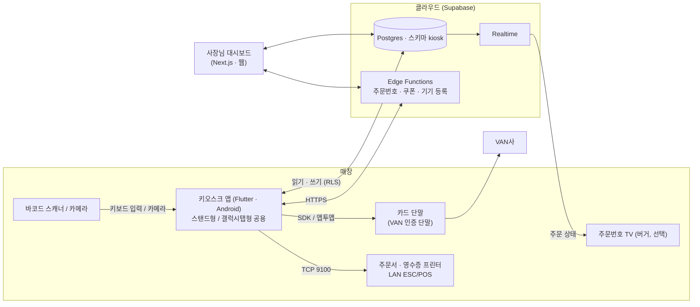

# 01 아키텍처

## 1. 전체 구조



## 2. 저장소 내부 구조

```
tablet-kiosk-core/
├── apps/
│   ├── kiosk/                       Flutter 앱 (task-001에서 생성)
│   │   └── lib/
│   │       ├── main.dart            진입점: 환경(dev/prod) · 기기 모드(real/fake) 선택
│   │       ├── app/                 라우터, 테마 주입, 의존성(Provider) 조립
│   │       ├── core/
│   │       │   ├── ui/              공통 컴포넌트 (DESIGN.md 6장)
│   │       │   ├── theme/           디자인 토큰, 업종 테마
│   │       │   ├── money/           금액(int 원) 계산 · 표시
│   │       │   ├── session/         주문 세션 (매장/포장, 장바구니)
│   │       │   ├── catalog/         메뉴 · 분류 · 품절
│   │       │   ├── payment/         결제 상태 흐름 (전체 · 더치)
│   │       │   ├── coupon/          쿠폰 입력 · 검증 호출
│   │       │   ├── printing/        주문서 양식 → ESC/POS 바이트, 출력 대기열
│   │       │   ├── setup/           사장님 세팅 5단계
│   │       │   ├── kiosk_lock/      키오스크 잠금 · PIN 해제
│   │       │   └── data/            Supabase 저장소, drift 로컬 DB, 동기화
│   │       ├── features/            손님 화면 (start, menu, cart, pay, coupon, done)
│   │       └── verticals/
│   │           ├── vertical_module.dart   업종 모듈 인터페이스
│   │           ├── restaurant/
│   │           ├── cafe/
│   │           └── burger/
│   └── admin/                       Next.js 사장님 대시보드 (task-022에서 생성)
├── packages/
│   └── kiosk_devices/               기기 인터페이스 + 진짜/가짜 구현 + Kotlin 플랫폼 코드
├── supabase/
│   ├── migrations/                  번호 붙은 SQL (기존 파일 수정 금지)
│   └── functions/                   Edge Functions
└── docs/ · tasks/
```

## 3. 계층 규칙

```
features (화면)  →  core (도메인 · 상태)  →  data (저장소)  →  Supabase / drift
                         ↓
                 kiosk_devices (인터페이스)  →  real / fake 구현
verticals  →  core 의 확장 지점에만 붙는다
```

- 화면은 상태(Riverpod Provider)만 보고 그립니다. 화면에서 Supabase · 기기를 직접 부르지 않습니다.
- `core`는 `verticals`를 import하지 않습니다. 업종 모듈은 `VerticalModule` 인터페이스로 주입됩니다. (`docs/08`)
- `kiosk_devices`는 앱 코드를 모릅니다. (순수 기기 패키지)

## 4. 데이터 흐름 — 주문 1건

1. 시작 화면: 주문 세션 생성 (`order_type = dine_in | takeout`), 로컬에만 존재
2. 메뉴 · 장바구니: 로컬 상태. 메뉴는 로컬 캐시(drift)에서 읽음
3. 결제 방법 선택: 서버에 주문 생성 (`status = pending_payment`), **주문 ID + 멱등 키 발급**
4. 카드 승인: `kiosk_devices.CardTerminal` → 승인 결과를 **로컬 outbox에 먼저 저장** → 서버에 결제 건 기록
5. 남은 금액 0원: 서버 함수로 주문 확정 + 주문번호 발급 (`status = paid`)
6. 출력: 주문서 양식 생성 → 출력 대기열 → 프린터. 실패 시 대기열에 남김
7. 완료 화면 → 일정 시간 후 시작 화면

## 5. 인터넷 끊김 정책

| 상황 | 동작 |
|---|---|
| 메뉴 조회 중 끊김 | 로컬 캐시로 계속 주문 받음 (마지막 동기화 시각 표시: 사장님 화면) |
| 결제 시작 전 끊김 | 카드 승인은 VAN 통신이 필요 → "지금은 결제할 수 없어요. 직원을 호출해 주세요" 안내 |
| **승인 후 서버 기록 실패** | 승인 결과는 로컬 outbox에 이미 저장됨 → 주문서는 **바로 출력** (임시 번호 `L-` 접두어) → 연결 복구 시 서버로 재전송, 번호 매핑 |
| 출력 실패 | 출력 대기열에 남기고 화면 상단에 "주문서 출력 대기 N건" 표시 (사장님 PIN으로 재출력) |

원칙: **돈을 받은 주문은 절대 잃지 않는다.** 로컬 기록 → 출력 → 서버 순서로 안전한 쪽을 먼저 합니다.

## 6. 인증 · 권한

| 주체 | 인증 | 권한 |
|---|---|---|
| 사장님 | Supabase Auth (방식은 `docs/00` D2) | 자기 매장(`store_id`) 데이터 전체 |
| 키오스크 기기 | 기기 등록 코드 → Edge Function이 기기 전용 계정 발급 | 자기 매장 메뉴 읽기, 주문 · 결제 건 쓰기만 |
| 손님 | 없음 | 스탬프는 전화번호로 조회만 (서버 함수 경유) |

RLS 규칙은 `docs/07-data-model.md`.

## 7. 환경

| 환경 | Supabase | 기기 모드 | 용도 |
|---|---|---|---|
| `dev` | 로컬 (`supabase start`) 또는 개발 프로젝트 | fake 기본 | 윈도우 PC 개발 |
| `staging` | 스테이징 프로젝트 | real | 시범 매장 전 실기 테스트 |
| `prod` | 운영 프로젝트 | real | 실제 매장 |

실행 시 `--dart-define=APP_ENV=dev --dart-define=DEVICE_MODE=fake` 형태로 고릅니다.
