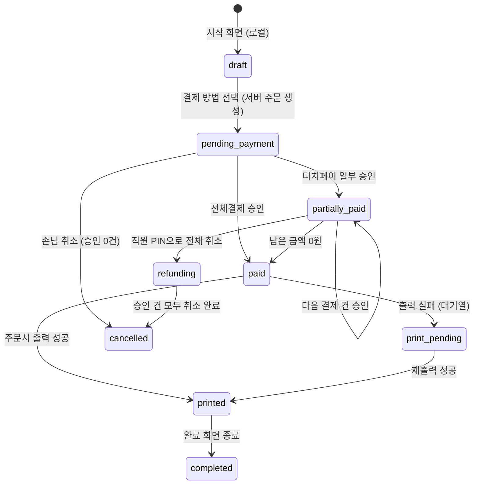

# 04 결제 — 전체결제 · 더치페이

> 위치: `apps/kiosk/lib/core/payment/`. 디자인: 업종 저장소의 결제 방법 · 더치페이 화면.

## 1. 주문 상태

## 2. 결제 건 상태

| 상태 | 뜻 | 다음 |
|---|---|---|
| `requested` | 단말에 승인 요청 보냄 | approved / declined / timeout / unknown |
| `approved` | 승인 완료 | (취소 시) cancelled |
| `declined` | 거절 | 같은 결제 건 다시 시도 (새 멱등 키) |
| `timeout` | 카드를 안 댐 | 다시 시도 |
| `unknown` | 통신 오류로 승인 여부 모름 | 상태 조회 → approved 또는 망취소 → 안 되면 직원 호출 |
| `cancelled` | 승인 취소됨 | — |

## 3. 전체결제

1. 결제 방법 화면에서 `전체결제` 선택 → 서버 주문 생성 (`pending_payment`)
2. 카드 단말 `approve(총액, 멱등키)`
3. 승인 → 로컬 outbox 기록 → 서버 결제 건 기록 → 주문 확정 (`paid`) → 출력
4. 거절 · 시간 초과 → 같은 화면에서 "다시 결제" / "결제 방법 바꾸기"

## 4. 더치페이

### 분할 방식

| 방식 | 계산 | 업종 메모 |
|---|---|---|
| N등분 | 총액 ÷ N, **나누어 떨어지지 않는 원 단위는 마지막 결제자에게 더함** (예: 10,000원 3명 → 3,333 / 3,333 / 3,334) — 디자인 안내 문구와 동일 | 공통 |
| 메뉴별 | 결제자가 자기 메뉴를 고름. 공유 메뉴는 나눠 담기 가능 | 식당은 고기 **인분 단위**로 나눔 (식당 모듈) |
| 금액 | 결제자가 금액 직접 입력, 남은 금액 이하만 허용 | 공통 |

### 규칙

- 분할 계획(`split_plan`)은 결제 시작 시 서버에 저장합니다. 결제 건마다 순번(`seq`)과 담당 항목 · 금액을 가집니다.
- 화면에는 항상 **남은 금액**과 **몇 번째 결제자**를 보여 줍니다.
- 결제 건 하나가 실패하면 **그 건만** 다시 시도합니다. 이미 승인된 건은 그대로 둡니다.
- 손님은 더치페이 시작 후 중간 취소를 할 수 없습니다. 취소는 **직원 PIN**으로만 하고, 이미 승인된 건을 모두 취소한 뒤 주문을 `cancelled`로 바꿉니다.
- 업종 모듈이 결제 건마다 추가 동작을 붙일 수 있습니다. (카페: 결제자별 전화번호 → 스탬프 적립 — `docs/08`)
- 무입력 시간 초과는 더치페이 진행 중에는 **적용하지 않습니다** (돈이 오가는 중 화면이 처음으로 가면 안 됨). 대신 직원 호출 안내를 띄웁니다.

## 5. 쿠폰과 결제

- 쿠폰은 결제 방법 화면에서 적용합니다. 적용 결과는 주문의 할인(`order_discounts`)으로 기록합니다.
- **권장안 (`docs/00` D4 안 A)**: 할인 후 금액이 결제 대상 총액이 되고, 더치페이 분할은 이 금액으로 계산합니다.
- 쿠폰 사용 확정(`redeem`)은 **결제가 모두 끝난 뒤** 서버에서 합니다. 결제 전에는 `reserve`(일시 예약, 10분)만 합니다. 결제가 취소되면 예약을 풉니다. (`docs/06`)

## 6. 멱등 키 · 중복 방지

- 결제 건마다 `idempotency_key = {orderId}-{seq}-{attempt}`를 만들고 단말 · 서버 양쪽에 같이 보냅니다.
- 서버 `payments` 테이블은 `idempotency_key`에 고유 제약을 둡니다. 같은 키로 두 번 기록하면 첫 기록을 돌려줍니다.
- 결제 버튼은 요청 중 비활성화하고, 화면 이동 · 뒤로가기를 막습니다.

## 7. 로컬 outbox

| 단계 | 저장 위치 |
|---|---|
| 승인 결과 수신 즉시 | drift `outbox_payments` (앱이 죽어도 남음) |
| 서버 기록 성공 | outbox 항목 `synced = true` |
| 서버 기록 실패 | 백그라운드 재시도 (점점 간격 늘림), 사장님 화면에 "서버 전송 대기 N건" |

앱 시작 시 outbox에 미전송 승인이 있으면 **가장 먼저** 처리합니다.

## 8. 취소 · 환불

| 경우 | 처리 |
|---|---|
| 결제 직후 손님 요청 (당일) | 사장님 PIN → 주문 상세 → 승인 취소 (`cancel(approvalNo, amount)`) → 취소 영수증 출력 |
| 더치페이 중단 | 위 4장 규칙 |
| 대시보드에서 취소 | 2차. 카드 취소는 단말이 있어야 하므로 키오스크 기기에서만 |

## 9. 테스트 시나리오 (가짜 기기로 윈도우에서)

- 전체결제 승인 / 거절 후 재시도 / 시간 초과
- 더치페이 3명 N등분, 2번째 거절 → 2번째만 재시도 → 완료
- 승인 직후 서버 끊김 → 임시 번호 출력 → 연결 복구 후 동기화
- `unknown`(통신 오류) → 상태 조회 승인 확인 / 망취소
- 결제 버튼 연타 → 승인 1번만
