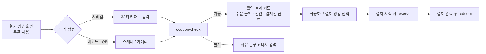

# 06 쿠폰

> 사장님: 대시보드에서 발행 (`apps/admin`). 손님: 키오스크에서 시리얼 입력 · 바코드 / QR 스캔 (`apps/kiosk/lib/core/coupon/`).
> 디자인: 업종 저장소의 `coupon-dashboard`, `coupon-create`, `hw-coupon-*`, `sw-coupon-*`.

## 1. 쿠폰 종류

| 혜택 종류 | 값 | 예 |
|---|---|---|
| 금액 할인 | 할인 금액(원), 최소 주문 금액 | 첫 방문 감사 5,000원 할인 (5만원 이상) |
| % 할인 | 할인율, 최대 할인 금액(선택) | 디저트 20% 할인 |
| 메뉴 무료 | 대상 메뉴 1개 금액만큼 할인 | 감자튀김 무료, 공깃밥 무료 |
| 1+1 | 대상 메뉴 2개 중 1개 금액 할인 | — |
| 업그레이드 | 옵션 추가금 면제 | 라지 업그레이드 무료, 사이즈업 |

공통 조건: 사용 기간, 사용 대상(매장 · 포장 · 메뉴 범위), 1장당 사용 횟수(기본 1회), 다른 쿠폰과 함께 사용 여부(기본 불가 — 주문당 쿠폰 1장).

## 2. 시리얼 규칙

| 항목 | 규칙 |
|---|---|
| 길이 | 12자, 표시 `XXXX-XXXX-XXXX` |
| 글자 | `ABCDEFGHJKLMNPQRSTUVWXYZ23456789` (32자) — `0 · O · 1 · I` 제외 |
| 앞 4자 | 매장 / 캠페인 식별 접두어 (예: `GB24`, `CF24`, `BR24`) |
| 생성 | 서버(Edge Function)에서만 생성. 암호학적 난수 사용, 중복 검사 |
| 저장 | 원문 + 정규화 값(대문자, 하이픈 제거) |
| 바코드 | Code128로 시리얼 원문 인코딩. QR은 시리얼 원문 (URL 아님) |
| 입력 정규화 | 소문자 → 대문자, 하이픈 · 공백 제거, `O→0` 같은 자동 변환은 하지 않음(애초에 없는 글자) |

## 3. 서버 함수 (Edge Functions)

| 함수 | 호출자 | 하는 일 |
|---|---|---|
| `coupon-issue` | 사장님 대시보드 | 캠페인 생성 + 시리얼 N개 생성. 엑셀(CSV) · 인쇄용 PDF 데이터 반환 |
| `coupon-check` | 키오스크 | 시리얼 + 현재 장바구니 → 사용 가능 여부, 할인 금액, 불가 사유 |
| `coupon-reserve` | 키오스크 | 결제 시작 시 10분 예약 (다른 기기에서 동시 사용 방지) |
| `coupon-redeem` | 키오스크 | 결제 완료 후 사용 확정 (주문 ID 기록) |
| `coupon-release` | 키오스크 | 결제 취소 시 예약 해제 (시간 지나면 자동 해제) |

불가 사유 코드와 손님 화면 문구:

| 코드 | 문구 |
|---|---|
| `not_found` | 쿠폰 번호를 다시 확인해 주세요 |
| `expired` | 사용 기간이 지난 쿠폰이에요 |
| `not_started` | 아직 사용할 수 없는 쿠폰이에요 (○월 ○일부터) |
| `used` | 이미 사용한 쿠폰이에요 |
| `min_amount` | ○○원 이상 주문하면 쓸 수 있어요 |
| `scope` | 이 메뉴 / 주문 유형에는 쓸 수 없는 쿠폰이에요 |
| `reserved` | 다른 주문에서 사용 중이에요. 잠시 후 다시 시도해 주세요 |
| `other_store` | 이 매장 쿠폰이 아니에요 |

## 4. 키오스크 흐름

- 12자가 모두 입력되면 자동으로 `coupon-check` 호출 (확인 버튼 없이).
- 인터넷이 끊기면 쿠폰은 사용할 수 없음 안내 ("지금은 쿠폰을 확인할 수 없어요").
- 한 주문에 쿠폰 1장. 다시 적용하면 기존 쿠폰을 바꿉니다.

## 5. 사장님 대시보드

| 화면 | 기능 |
|---|---|
| 쿠폰 관리 (`coupon-dashboard`) | 진행 중 쿠폰 수, 이번 달 발행, 사용 · 사용률, 쿠폰 사용 주문 매출, 발행 목록(전체 · 진행 중 · 종료), 오늘 사용 기록, 사용 방식 비율 |
| 쿠폰 발행 (`coupon-create`) | 혜택 종류 · 값 · 조건 · 기간 · 수량 · 대상, 발행 방식(시리얼 자동 생성 · 바코드 / QR 이미지 · 문자 · 영수증 하단 인쇄), 미리보기 |

- 문자 발송은 외부 문자 서비스 연동 (2차, 서비스 미정).
- 영수증 하단 인쇄 쿠폰: 결제할 때마다 시리얼 1개를 발급해 영수증 푸터에 바코드와 함께 인쇄.
- 카페 스탬프 10개 무료 쿠폰은 스탬프 모듈이 자동 발급하고, 목록에 `자동`으로 표시. (카페 설계 저장소 참고)

## 6. 보안

- 시리얼 검증은 서버에서만. 키오스크에 쿠폰 목록을 내려받지 않습니다.
- `coupon-check`는 기기 인증 필요 + 기기당 분당 호출 제한 (무작위 대입 방지).
- 사용 기록에 주문 ID · 기기 ID · 시각 · 입력 방식(시리얼 / 바코드)을 남깁니다 (대시보드 사용 방식 비율의 근거).
