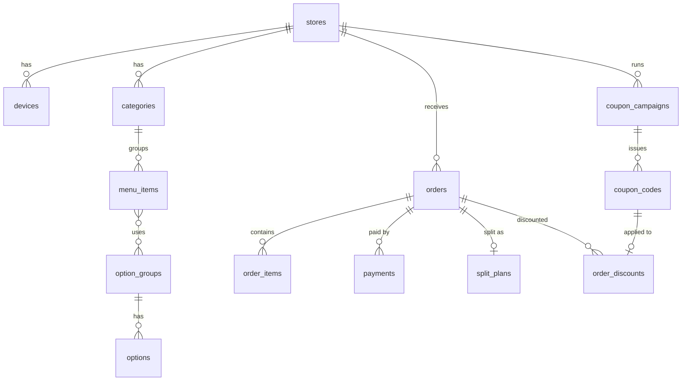

# 07 데이터 모델

> Supabase Postgres, 스키마 `kiosk`. 실제 SQL은 `supabase/migrations/`에 번호 파일로 작성합니다 (task-005부터).
> 이 문서는 설계입니다. 바꿀 때는 문서를 먼저 고치고 새 번호 마이그레이션을 추가합니다.

## 1. 공통 규칙

- 모든 매장 데이터 테이블은 `store_id`를 가집니다 (매장별 분리 · RLS 기준).
- 기본 키 `uuid`, 시각 `timestamptz`, 금액 `integer`(원).
- 주문 항목 · 할인은 **스냅샷**(당시 이름 · 가격)을 저장합니다. 메뉴가 바뀌어도 과거 주문은 그대로.
- 업종 전용 값은 `vertical_attrs` / `vertical_data` (`jsonb`)에 넣고, 키 목록은 업종 설계 저장소에 정의합니다. 조회 · 집계가 많아지면 그때 컬럼으로 승격합니다.
- Supabase API에서 `kiosk` 스키마를 노출 스키마(Exposed schemas)에 추가해야 합니다.

## 2. 테이블

### 매장 · 기기

| 테이블 | 주요 컬럼 | 비고 |
|---|---|---|
| `stores` | `id`, `owner_id`(auth.users), `name`, `vertical`(`restaurant`·`cafe`·`burger`), `business_no`, `address`, `phone`, `settings`(jsonb), `created_at` | `settings`: 무입력 시간, 주방 프린터 사용, 금액 인쇄 여부 등 |
| `devices` | `id`, `store_id`, `name`, `form_factor`(`stand`·`tablet`), `app_version`, `printer_config`(jsonb), `terminal_config`(jsonb), `last_seen_at` | 기기 1대 = 1행 |
| `device_registration_codes` | `code`(6자리), `store_id`, `expires_at`, `used_at`, `device_id` | 세팅 1단계에서 사용 |

### 메뉴

| 테이블 | 주요 컬럼 | 비고 |
|---|---|---|
| `categories` | `id`, `store_id`, `name`, `sort`, `is_active` | |
| `menu_items` | `id`, `store_id`, `category_id`, `name`, `description`, `price`, `image_path`, `badges`(text[]), `is_sold_out`, `is_active`, `sort`, `vertical_attrs`(jsonb) | 식당 `portion_unit` · `is_alcohol`, 버거 `set_config` 등 |
| `option_groups` | `id`, `store_id`, `name`, `min_select`, `max_select`, `sort` | 카페 온도 · 사이즈 · 샷 · 컵, 버거 사이드 · 음료 |
| `options` | `id`, `group_id`, `name`, `price_delta`, `is_sold_out`, `sort` | |
| `menu_item_option_groups` | `menu_item_id`, `group_id`, `sort` | 연결 |

### 주문 · 결제

| 테이블 | 주요 컬럼 | 비고 |
|---|---|---|
| `orders` | `id`, `store_id`, `device_id`, `order_type`(`dine_in`·`takeout`), `status`, `subtotal`, `discount_total`, `total`, `order_no`, `local_temp_no`, `kitchen_status`(`received`·`preparing`·`ready`·`picked_up`), `vertical_data`(jsonb), `created_at`, `paid_at`, `cancelled_at` | 상태는 `docs/04` 1장 |
| `order_items` | `id`, `order_id`, `menu_item_id`, `name_snapshot`, `unit_price`, `qty`, `options_snapshot`(jsonb), `line_total`, `kitchen_group` | 식당 분류별 출력용 `kitchen_group` |
| `order_discounts` | `id`, `order_id`, `coupon_code_id`, `label`, `amount` | |
| `split_plans` | `order_id`(PK), `mode`(`equal`·`by_item`·`by_amount`), `parts`, `plan`(jsonb) | 더치페이 |
| `payments` | `id`, `order_id`, `seq`, `amount`, `status`, `idempotency_key`(unique), `approval_no`, `masked_card`, `card_issuer`, `terminal_id`, `payer_label`, `approved_at`, `cancelled_at` | **카드 정보 저장 금지** |
| `daily_order_counters` | `store_id`, `business_date`, `last_no` (PK: store_id + business_date) | 주문번호 발급 (서버 함수에서 잠금 후 +1) |

### 쿠폰

| 테이블 | 주요 컬럼 | 비고 |
|---|---|---|
| `coupon_campaigns` | `id`, `store_id`, `name`, `benefit_type`, `benefit_value`, `min_amount`, `max_discount`, `target_menu_ids`(uuid[]), `order_types`(text[]), `starts_at`, `ends_at`, `uses_per_code`, `quantity`, `issue_methods`(text[]), `is_auto`, `status` | `is_auto`: 카페 스탬프 자동 쿠폰 |
| `coupon_codes` | `id`, `campaign_id`, `store_id`, `code`, `code_norm`(unique), `status`(`issued`·`reserved`·`used`·`void`), `reserved_until`, `reserved_order_id`, `used_order_id`, `used_device_id`, `used_via`(`serial`·`barcode`), `used_at`, `issued_via` | |

### 업종 전용 (해당 업종 모듈 작업에서 추가)

| 업종 | 테이블 | 비고 |
|---|---|---|
| 카페 | `stamp_members`, `stamp_ledger` | 전화번호는 **개인정보** — 수집 동의, 암호화 저장, 조회용 해시 분리. 카페 설계 저장소 참고 |
| 버거 | (없음 — `orders.order_no`, `kitchen_status` 사용) | TV 화면은 Realtime 구독 |
| 식당 | (없음 — `vertical_attrs` 사용) | |

## 3. 관계도

## 4. 접근 권한 (RLS)

| 주체 | 판별 | 허용 |
|---|---|---|
| 사장님 | `stores.owner_id = auth.uid()` | 자기 매장의 모든 테이블 읽기 · 쓰기 |
| 키오스크 기기 | 기기 계정 JWT의 `store_id` 클레임 | 메뉴 · 옵션 읽기, `orders` · `order_items` · `payments` · `split_plans` 쓰기(자기 매장), 자기 주문 상태 변경 |
| 손님 · 익명 | — | 직접 접근 없음. 쿠폰 · 스탬프는 Edge Function 경유 |

- 주문번호 발급, 주문 확정, 쿠폰 예약 · 확정은 **Edge Function(서비스 권한)**에서만 처리합니다. 기기가 직접 `daily_order_counters` · `coupon_codes`를 쓰지 않습니다.
- RLS 정책마다 "다른 매장 데이터가 보이지 않는다" 테스트를 둡니다 (`supabase/tests/`).

## 5. 로컬 DB (drift, 키오스크 앱)

| 테이블 | 용도 |
|---|---|
| `cached_menu` 계열 | 서버 메뉴 · 옵션 사본, 마지막 동기화 시각 |
| `outbox_payments` | 승인 결과 즉시 저장, 서버 전송 여부 |
| `outbox_orders` | 서버 생성 실패한 주문 (임시 번호) |
| `print_jobs` | 출력 대기열 (`docs/05`) |
| `device_settings` | 업종, 형태, 프린터 · 단말 설정, 사장님 PIN 해시 |
