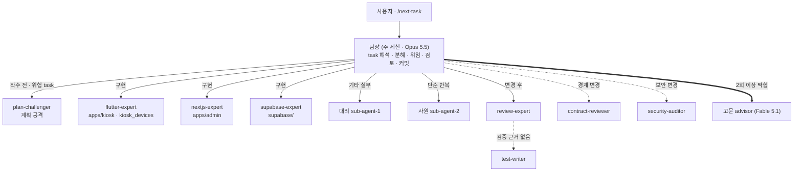

# 11 멀티에이전트 — 팀으로 개발하기

> Claude Code 세션 하나가 **팀장**이 되어, 작업을 나눠 팀원 에이전트에게 맡기고 결과를 검토합니다.
> 에이전트 정의는 `.claude/agents/`, 분야 규약은 `.claude/skills/`에 있습니다.
> 출처: [MultiAgent-Service-Fullstack-Tree-Framwork](https://github.com/DevOps0906/MultiAgent-Service-Fullstack-Tree-Framwork)에서 이 프로젝트에 필요한 부분만 옮겨 고쳤습니다 (7장).

## 1. 구조

- 팀원은 서로를 부르지 않습니다. **모든 호출은 팀장이 중개**합니다 (깊이 1).
- 검증 에이전트는 코드를 고치지 않습니다. 고치는 일은 분야 에이전트에게 돌려보냅니다.
- 리뷰어끼리는 서로의 결과를 보지 않고 각자 판단합니다 (형제 호출).

## 2. 팀 구성

| 분류 | 에이전트 | 모델 | 쓰기 | 맡는 일 |
|---|---|---|---|---|
| 고문 | `advisor` | `claude-fable-5-1` | 없음 | 팀장이 2회 이상 막힌 문제 진단 · 권고 |
| 팀장 | (주 세션) | `claude-opus-5-5` | 전체 | 위임 · 검토 · 커밋 |
| 대리 | `sub-agent-1` | `claude-sonnet-5-5` | 있음 | 분야 밖 판단 필요 실무, 리뷰 지적 반영 |
| 사원 | `sub-agent-2` | `claude-haiku-5-5` | 있음 | 탐색 · 값 추출 · 시드 정리 · 형식 점검 |
| 분야 | `flutter-expert` | `claude-sonnet-5-5` | 있음 | 키오스크 앱 · 기기 패키지 |
| 분야 | `nextjs-expert` | `claude-sonnet-5-5` | 있음 | 사장님 대시보드 |
| 분야 | `supabase-expert` | `claude-sonnet-5-5` | 있음 | DB · RLS · Edge Function |
| 검증 | `plan-challenger` | `claude-opus-5-5` | 없음 | 착수 전 계획 공격 |
| 검증 | `review-expert` | `claude-sonnet-5-5` | 없음 | 변경 후 리뷰 · 추적성 |
| 검증 | `contract-reviewer` | `claude-sonnet-5-5` | 없음 | 경계 계약 대조 |
| 검증 | `security-auditor` | `claude-sonnet-5-5` | 없음 | 보안 심층 감사 |
| 검증 | `test-writer` | `claude-sonnet-5-5` | 테스트만 | 테스트 작성 · 실행 |

## 3. 누구에게 맡기나

### 3.1 구현

| 작업 | 담당 |
|---|---|
| `apps/kiosk` 화면 · 상태 · 업종 모듈, `packages/kiosk_devices` | flutter-expert |
| `apps/admin` | nextjs-expert |
| `supabase/` 마이그레이션 · RLS · Edge Function · 시드 | supabase-expert |
| 문서 수정, 여러 영역에 걸친 작은 수정, 리뷰 지적 반영 | 대리 |
| 설계 저장소에서 문구 · 금액 · 목록 추출, 시드 정리, 일괄 변환, 파일 탐색 | 사원 |
| 한 줄 수정 등 위임 비용이 더 큰 일 | 팀장 직접 |

**대리 vs 사원**: 규칙을 한 문장으로 줄 수 있고 결과를 기계적으로 확인할 수 있으면 사원, 기존 동작이 바뀌면 대리.

### 3.2 검증 — 어떤 리뷰를 붙이나

| 상황 | 붙이는 에이전트 | 시점 |
|---|---|---|
| 모든 구현 task | review-expert | 변경 후 |
| 결제 · 더치페이 · 쿠폰 · 출력 · 기기 · DB 스키마 · 업종 모듈 구조 | + plan-challenger | 착수 전 |
| 앱 ↔ DB ↔ 대시보드, 공통 ↔ 업종, 앱 ↔ 기기 경계 변경 | + contract-reviewer | 변경 후 (형제) |
| 결제 · 쿠폰 · 기기 등록 · 잠금 · 개인정보 변경 | + security-auditor | 변경 후 (형제) |
| 리뷰가 "검증 근거 없음" | test-writer → review-expert 재실행 | 후행 |

### 3.3 task 별 기본 배치

| task | 착수 전 | 구현 | 변경 후 |
|---|---|---|---|
| 001–002 앱 생성 · 토큰 | — | flutter-expert | review |
| 003 업종 모듈 구조 | plan-challenger | flutter-expert | review · contract |
| 004 기기 패키지 · 가짜 기기 | plan-challenger | flutter-expert | review · contract |
| 005 Supabase 스키마 · RLS | plan-challenger | supabase-expert (+ 사원: 시드) | review · security |
| 006 데이터 계층 · outbox | plan-challenger | flutter-expert | review · contract |
| 007–010 손님 화면 | — | flutter-expert (+ 사원: 문구 · 금액 추출) | review |
| 011 결제 상태 흐름 | plan-challenger | flutter-expert | review · security · test-writer |
| 012 출력 | plan-challenger | flutter-expert | review · contract |
| 014–015 세팅 · 잠금 | plan-challenger(015) | flutter-expert (+ supabase-expert: 기기 등록) | review · security |
| 016–017 실기 | plan-challenger | flutter-expert | review · security |
| 018 더치페이 | plan-challenger | flutter-expert | review · test-writer |
| 019 스탬프 | plan-challenger | flutter-expert + supabase-expert | review · security · contract |
| 020–021 쿠폰 | plan-challenger | supabase-expert → flutter-expert | review · security · contract · test-writer |
| 022 대시보드 | — | nextjs-expert | review · security · contract |
| 023–024 식당 · 버거 모듈 | plan-challenger | flutter-expert (+ 사원: 메뉴 시드) | review · contract |
| 027 출시 | — | — | security-auditor 전체 감사 |

## 4. 고문 호출 규칙

1. 팀장이 원인을 다시 분석하고 지시를 고쳐 써도 **같은 문제로 2회 이상 실패**했을 때만 부릅니다.
2. 문제 상황, 시도한 방법과 실패 원인, 관련 파일 경로, 결정할 질문을 정리해 넘깁니다.
3. 고문의 권고는 참고 의견입니다. 최종 결정과 실행 지시는 팀장이 합니다.
4. 가장 비싼 모델이므로 일상 작업 · 착수 전 검토(plan-challenger 몫)에는 부르지 않습니다.

## 5. 위임 규칙 (팀장)

1. 위임 전 작업을 명확한 단위로 나누고, 범위 · 대상 파일 · 완료 기준 · task 의 "안 할 것"을 지시에 넣습니다.
2. 지시에는 **문서 내용을 붙여 넣지 말고 경로만** 줍니다 (예: `docs/04-payment.md 6장`). 팀원이 직접 읽습니다.
3. 사원에게는 규칙과 예시를 함께 줍니다. 규칙이 모호하면 대리에게 넘깁니다.
4. 팀원이 "팀장 확인 필요"로 보고한 사항은 팀장이 결정합니다. 설계와 다르게 가야 하면 루트 CLAUDE.md 2장 5번대로 문서부터 고칩니다.
5. 같은 문제로 2회 이상 막히면 팀장이 지시를 다시 쓰고, 사원이 막힌 일은 대리에게 넘깁니다. 그래도 안 되면 고문.
6. 팀원은 commit · push 하지 않습니다. 커밋은 팀장만 합니다.

## 6. 비용 · 토큰 줄이기

| 방법 | 내용 |
|---|---|
| 탐색은 사원에게 | 여러 파일을 훑는 일을 Haiku 에게 맡기고 결론만 받습니다 |
| 문서는 필요한 장만 | task 참고 문서를 통째로 읽지 않습니다. 지시에도 장 번호까지 적습니다 |
| 검증은 필요한 만큼 | 3.2 표에 해당할 때만 붙입니다. 같은 리뷰를 반복하지 않습니다 (실패 시만 재실행) |
| task 하나 끝나면 `/clear` | 다음 task 는 새 맥락에서 시작합니다. 진행 상태는 `tasks/README.md`와 커밋에 남아 있습니다 |
| 고문은 마지막 수단 | Fable 은 Opus 의 약 2.5배 비용입니다 |

## 7. 프레임워크에서 옮긴 것 · 옮기지 않은 것

| 프레임워크 구성 | 이 저장소 | 이유 |
|---|---|---|
| 직급형 구조 (`docs/reference/Agents-CLAUDE.md`: 고문 · 팀장 · 대리 · 사원) | ✅ `advisor` · `sub-agent-1` · `sub-agent-2` · `settings.json` | 사용자 확정 직급 구조 |
| 운영 원칙 4원칙 | ✅ 루트 `CLAUDE.md` 8장 (한국어로 고침, `NOTICE`) | 모든 작업에 적용 |
| 검증 에이전트 `plan-challenger` · `review-expert` · `contract-reviewer` · `security-auditor` · `test-writer` | ✅ 결제 · 기기 · 업종 모듈 · RLS 기준으로 내용 재작성 | 결제 · 개인정보를 다루는 제품 |
| `nextjs-expert` · `supabase-expert` 에이전트 + 스킬 | ✅ `apps/web` → `apps/admin`, 키오스크 규칙 반영 | 대시보드 · 서버가 같은 스택 |
| `flutter-expert` | ➕ 새로 만듦 (프레임워크에 없음) | 이 제품의 중심이 Flutter |
| `/agent-check` 명령 | ✅ 단순화 | 팀 구성 점검 |
| `fastapi-expert` · `apps/api` | ❌ | 이 프로젝트에 별도 API 서버 없음 (Edge Function 사용) |
| 워커 풀 `claude-main` · `claude-reviewer` + 승인 게이트(`gate.sh` · `scope_check.sh` · `workers_approved` · `tasks/<task>/` 폴더 · `log.md`) | ❌ | 이 저장소는 `tasks/README.md` + `task-XXX.md` + 커밋으로 진행을 기록. 팀장 = 주 세션, 리뷰는 review-expert 가 맡음. 1인 개발에 승인 로그는 과함 |
| 산출물 근거 개발 `docs/file/` · `deliverable-first` 스킬 | ❌ (개념만 반영) | 근거 문서는 이미 `docs/` + 업종 설계 저장소 `specs/` — review-expert 추적성이 이것을 씀 |
| 개발 위키 `docs/wiki/` · `llm-wiki` · `wiki-lint.py` | ❌ | `docs/`와 설계 저장소가 같은 역할 |
| KNOT vault | ❌ | 하네스 운영 지식용 (프로젝트 밖) |
| 디자인 스킬 `design-process` · `frontend-design` · `ui-ux-pro-max` | ❌ | 디자인은 설계 저장소에서 확정됨. 구현은 원본(`design/` · `screenshots/`)에 맞춤 |
| `init-project.sh` · `_templates/` · `md2pdf` · 요구사항 TASK 전환 양식 | ❌ | task 문서가 이미 있음 |

프레임워크를 고친 뒤 이 저장소에 다시 반영하려면 이 표를 기준으로 ✅ 항목만 비교합니다.
