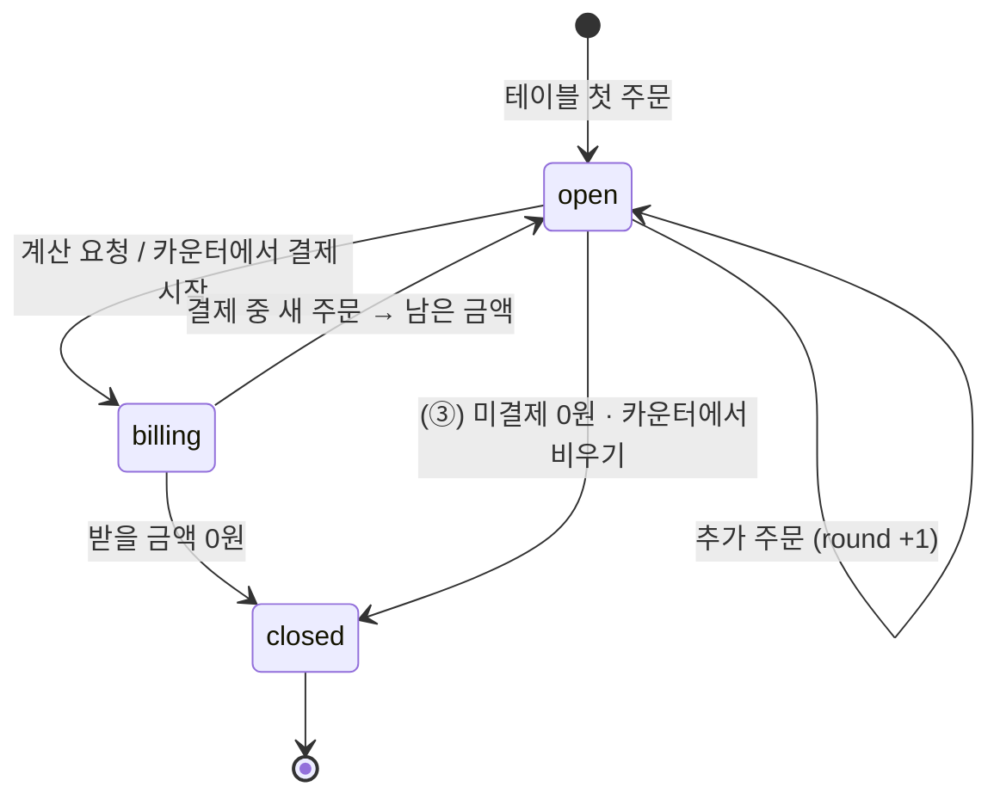
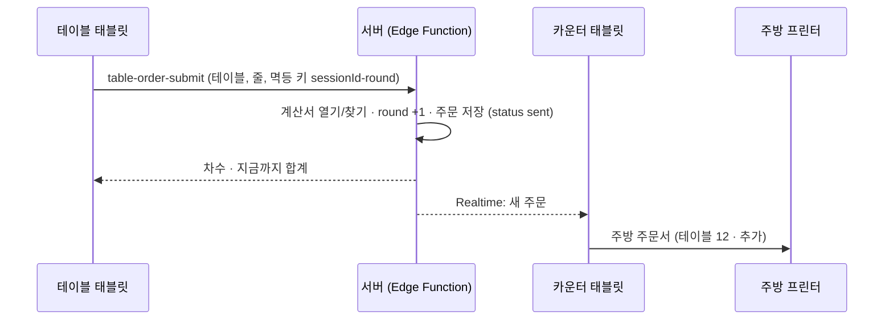
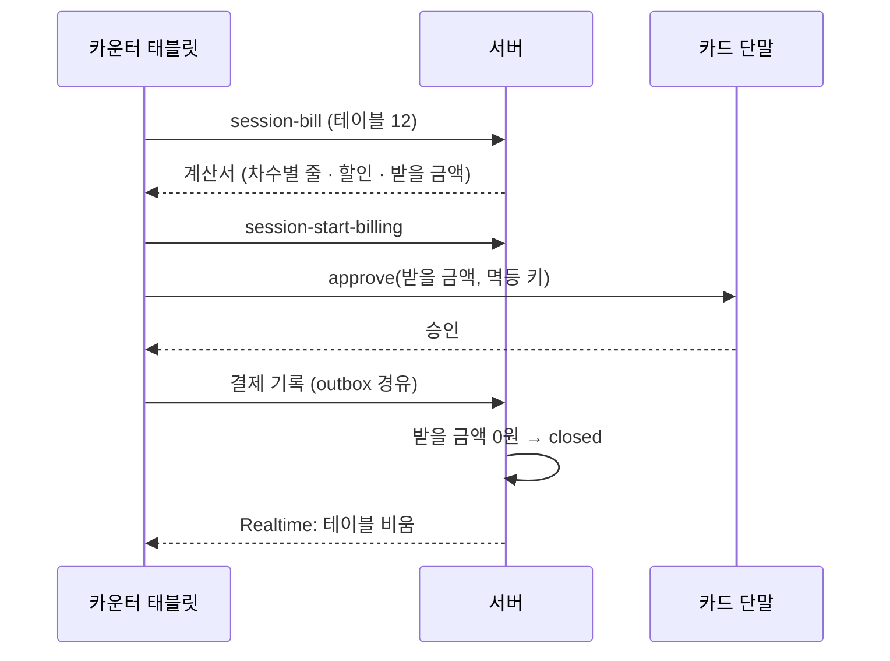

# 12 운영 방식 — 카운터 키오스크 · 테이블오더(후불 · 선불)

> 운영 방식은 **업종이 아니라 매장 설정**입니다 (`stores.operation_mode`). 고깃집뿐 아니라 주점 · 카페도 같은 기능을 씁니다.
> 그래서 코드는 `verticals/`가 아니라 **core 공통 기능**으로 만듭니다. 업종 분기 금지 규칙(`docs/08` 4장)과 같은 원리로, 공통 코드는 `operation_mode` 값에 따라 흐름을 고르되 업종 이름으로 분기하지 않습니다.
> 화면 · 동작 기준 설계: [goki-kiosk-restaurant](https://github.com/DevOps0906/goki-kiosk-restaurant) `docs/03-operation-modes.md` · `specs/` (두 문서는 같은 내용을 말해야 합니다).

## 1. 세 가지 방식

| 값 | 이름 | 주문 기기 | 결제 시점 · 장소 | 주방 전송 |
|---|---|---|---|---|
| `counter_prepaid` | ① 카운터 키오스크 | 입구 · 카운터 키오스크 | 주문할 때 · 키오스크 카드 단말 | 결제 승인 후 |
| `table_postpaid` | ② 테이블오더 · 나갈 때 결제 | 테이블 태블릿 | 나갈 때 · 카운터 | **주문 즉시** |
| `table_prepaid` | ③ 테이블오더 · 주문할 때 결제 | 테이블 태블릿 | 주문할 때 · 손님 휴대폰 간편결제(PG) | 결제 승인 후 |

옵션(`stores.settings`): `counter_postpaid_enabled`(① 에서 테이블 번호 입력 후 나갈 때 결제), `allow_mobile_prepay`(② 에서 휴대폰 선결제 허용), `allow_pay_later`(③ 에서 나갈 때 결제 허용, 기본 켬).
지금까지의 MVP(카페)는 ① 입니다. ② ③ 은 task-028 ~ 034 (Phase 6b).

## 2. 기기 역할

앱은 하나이고, 기기마다 **역할**을 지정합니다 (`devices.role`, 세팅 4-3).

| 역할 | 첫 화면 | 할 수 있는 일 | 카드 단말 · 프린터 |
|---|---|---|---|
| `entrance_kiosk` | ① 시작 화면 | ① 주문 · 결제 | 있음 |
| `table` | 테이블 대기 화면 (`devices.table_id`) | ② ③ 주문 · 호출 · 내역 · (③) 결제 QR | 없음 |
| `counter` | 테이블 현황판 | 계산서 · 결제 · 이동 · 합석 · 호출 처리 · 주방 출력 담당 | 있음 |

- 라우터는 역할에 따라 시작 경로를 고릅니다: `/start` · `/table` · `/counter`. 역할 밖 경로는 열지 않습니다.
- ① 매장은 지금처럼 `entrance_kiosk` 1~2대(+ 선택적으로 `counter`)로 동작합니다.

## 3. 핵심 개념: 열린 계산서 (`table_sessions`)



- 테이블당 열린 계산서는 하나 (`unique (table_id) where status <> 'closed'`).
- 주문 1번 = 1차(`orders.round_no`). 주문은 계산서에 속하고(`orders.table_session_id`), ② 주문은 결제 없이 `sent` 상태로 주방에 갑니다.
- 결제는 **계산서 단위**(`payments.table_session_id`). 기존 결제 흐름(`docs/04`)을 그대로 쓰되 대상 금액 = 계산서 받을 금액.
- 이동 = 계산서의 `table_id` 변경. 합석 = 한 계산서의 주문을 다른 계산서로 옮기고 원래 계산서 `closed`(`merged_into` 기록).
- 상태 · 금액 계산은 **서버 함수**에서만 (계산서 열기 · 주문 추가 · 취소 · 이동 · 합석 · 닫기). 기기는 결과만 받습니다.

## 4. 흐름

### ② 주문 → 주방



### ② 나갈 때 결제



③ 은 `table-prepay-create`(PG 결제 요청 · QR) → PG 웹훅 `table-prepay-webhook`(승인 확인 · 주문 `sent`) 순서이며, PG가 정해진 뒤(D9) 상세를 씁니다.

## 5. 서버 함수 (Edge Functions)

| 함수 | 호출자 | 하는 일 |
|---|---|---|
| `table-order-submit` | 테이블 · (①옵션) 입구 키오스크 | 계산서 열기/찾기, 차수 부여, 주문 저장, 첫 고기 주문 판정 결과 반환 |
| `session-bill` | 카운터 · 테이블(내역) | 계산서 조회 (차수별 · 취소 · 할인 · 받을 금액) |
| `session-item-cancel` | 카운터 | 줄 취소(사유, 권한 확인) → 주방 취소 출력 이벤트 |
| `session-move` / `session-merge` | 카운터 | 이동 · 합석 |
| `session-start-billing` / `session-close` | 카운터 | 결제 시작 표시 · 닫기 (받을 금액 0원 확인) |
| `staff-call` / `staff-call-done` | 테이블 / 카운터 | 호출 만들기(같은 항목 중복 방지) · 처리 |
| `table-prepay-create` / `table-prepay-webhook` | 테이블 / PG | ③ 결제 (D9 이후) |
| `device-pair` | 새 기기 | 연결 코드 확인 · 역할 · 테이블 지정 |

## 6. 실시간 동기화

- Supabase Realtime 채널 `store:{store_id}` 하나로 테이블 상태 · 새 주문 · 호출 · 계산서 닫힘을 보냅니다.
- 테이블 태블릿은 자기 `table_id` 이벤트만, 카운터는 매장 전체를 구독.
- 목표: 주문 → 카운터 현황판 반영 2초 이내.

## 7. 출력 담당

- MVP: **카운터 태블릿이 주방 출력 담당** (기존 `docs/05` 출력 대기열 재사용). 테이블 태블릿은 프린터와 직접 연결하지 않습니다.
- 카운터 태블릿이 꺼져 있으면 서버에 출력 대기 상태로 남고, 켜지면 순서대로 출력. 2차: 프린터 전용 브리지 기기 또는 클라우드 프린터 (D10).

## 8. 인터넷 끊김

| 기기 | 정책 |
|---|---|
| 테이블 | 주문 보내기 막음 + "직원을 불러 주세요". 로컬 대기열 없음 (재전송 중복 위험 > 이점) |
| 카운터 | 마지막 계산서로 카드 결제 가능, 결제 기록은 outbox (`docs/04` 7장). 계산서 닫기는 복구 후 |
| 입구 키오스크 (①) | 기존 정책 (`docs/01` 5장) |

## 9. 구현 위치

```
apps/kiosk/lib/
├── core/
│   ├── operation/        운영 방식 · 기기 역할 · 시작 경로 결정
│   ├── table/            테이블 · 계산서 · 차수 · 호출 (서버 함수 호출, Realtime 구독)
│   └── payment/          (기존) 결제 대상에 "계산서" 추가
└── features/
    ├── table_order/      테이블 태블릿 화면 (대기 · 메뉴 · 확인 · 완료 · 내역 · 호출 · ③ QR)
    └── counter/          카운터 화면 (현황판 · 계산서 · 이동 · 합석)
```

업종 모듈이 채우는 것: 호출 항목(`labels.staffCallItems`), 첫 주문 최소 수량(`cartRules`에 "계산서 첫 주문 여부" 전달), 주방 주문서 블록, 기본 운영 방식(`preset.defaultOperationMode`). → `docs/08` 2장.
